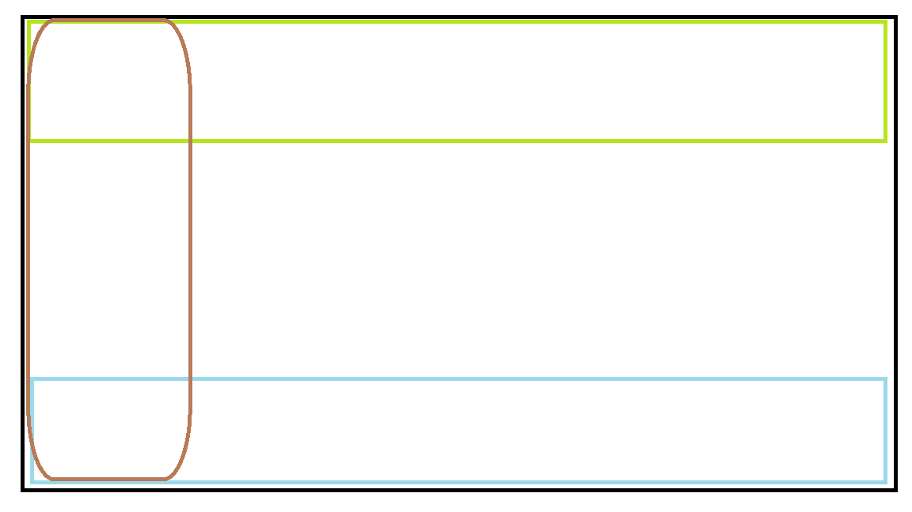

# 909 — Vérifier et enrichir : correctifs, puis comparaison ancienne UI / `/suite`

État : en cours de rédaction, point par point avec Sednal (09/11/2026).

Hors du pavé du 02/11, suite à une question de Sednal le 09/11/2026 (« est-ce que vérifier et enrichir
pourraient être améliorées ? »). Deux volets, dans cet ordre :

1. Corriger les défauts trouvés en relisant le code de vérifier et d'enrichir (ci-dessous, vérifier
   d'abord, enrichir ensuite).
2. **Comparer systématiquement l'ancienne UI et `/suite`**, fonctionnalité par fonctionnalité — pas
   seulement vérifier/enrichir — et mettre `/suite` à jour partout où elle est en retard. Ce volet
   élargit 905 (qui ne traitait que l'ajout de source et les menus fermés) à l'ensemble des deux UIs.

## 1 — Vérifier

### 1.1 — Trois correctifs décidés le 09/11/2026

**a) Réglage global absent de `/suite`.** « Vérification active » et le mode (« memes » / « plus »,
`reg["verification"]`) ne se règlent aujourd'hui qu'à l'installation de première fois (assistant,
`installation.js` étape 2), ou via l'ancienne UI (`PUT /reglages/verification`). Décision : ajouter
cette case dans Réglages transverse de `/suite`, même traitement que toute autre case fermée (règle
d'affichage 3.10 de 908 si le choix dépasse 4 options).

**b) La fiche source de `/suite` n'affiche qu'un seul rôle.** 36 sources sur 79 sont déclarées
`chercher` + `verifier` (ou `chercher` + `enrichir`) à la fois — voir liste en annexe du point 2. Le
calcul qui affiche le rôle (`suite_reel.py` ligne 125 : `role = sur.get("role") or ("CHERCHER" if
"chercher" in d.roles else "VERIFIER" if "verifier" in d.roles else "ENRICHIR")`) ne garde que le
premier trouvé, toujours CHERCHER pour ces sources — leur vérification/enrichissement est active mais
invisible dans leur fiche. Décision : le champ « Rôle » de la fiche devient **à choix multiples** (une
case par rôle déclaré : CHERCHER, VERIFIER, ENRICHIR), reflétant la liste réelle de `Declaration.roles`
au lieu d'un seul choix qui en masque les autres.

**c) Le bouton marche/arrêt casse la vérification des sources à double rôle — bug.**
`suite_reel.allumer()` pose `"verifier": allumee and "verifier" in d.roles and "chercher" not in
d.roles` : pour une source `chercher`+`verifier`, ce booléen est toujours faux, quel que soit
`allumee`. Éteindre puis rallumer wikidata ou ror depuis le bouton marche/arrêt de `/suite` remet donc
`verifier` à faux et ne le remet **jamais** à vrai — perte silencieuse et permanente de la vérification,
jusqu'à correction manuelle du fichier de réglages. Décision : corriger `allumer()` pour qu'il pose
chaque rôle déclaré indépendamment (`chercher` et `verifier` suivent chacun `allumee`, sans condition
d'exclusion mutuelle).

### 1.2 — Amélioration décidée le 09/11/2026

Rappel du rôle de la fonction (clarifié avec Sednal) : vérifier n'apporte jamais de nouveau nom, elle
apporte de la **fiabilité** à ce qui a déjà été trouvé, en repassant chaque fiche par une autre source
de la liste des 79. Les six pistes ci-dessous sont retenues.

**a) Rendre visible le signal « alerte ».** Une alerte (ex. liste de sanctions) n'apparaît aujourd'hui
que dans la fiche du candidat en Tri. À faire apparaître aussi dans le Tableau de bord (rejoint le
trou d'affichage déjà noté en 908 point 2).

**b) Montrer le coût réel d'une source de vérification payante avant usage.** Le mécanisme « test
réel, prix annoncé avant clic » (`tests_source.py`) existe mais seulement côté ancienne UI
(`api_reglages.py`) : à brancher aussi dans `/suite` (`api_suite.py`) pour les sources utilisées en
vérification.

**c) Permettre de restreindre « qui vérifie quoi » en recherche simple.** `en_amont` (ne vérifier que
les candidats trouvés par telle source) n'existe aujourd'hui que dans le plan avancé
(`suite_plan.py`). À exposer aussi en simple, pour économiser des appels coûteux sur une partie
seulement des résultats.

**d) Faire que la fiabilité apportée par vérifier compte réellement — le point le plus important.**
Constat en lisant le code : une fois qu'une vérification renvoie confirmation ou alerte
(`faits.verifications`), **rien ne l'utilise automatiquement**. Le filtre « Fiabilité minimale »
(`suite_plan.py` ligne 523, commentaire : « la meilleure fiabilité parmi les sources qui ont trouvé
ce nom ») ne regarde que la fiabilité déclarée des sources de RECHERCHE, jamais un résultat de
vérification. Aucun tri, aucun classement ne la lit non plus : cette fiabilité n'existe que si une
personne ouvre la fiche du candidat en Tri. Décidé : la vérification doit avoir un effet réel, pas
seulement un affichage —
  - une confirmation par une source première main peut faire remonter la fiabilité effective du
    candidat au-dessus de celle de sa seule source de recherche ;
  - une alerte doit faire ressortir le candidat (visuellement, ou en le remontant) sans attendre
    qu'une personne l'ouvre.
  Détail d'implémentation (calcul exact de la fiabilité effective, seuils) laissé à momo ; ce qui est
  tranché ici, c'est que le résultat de vérifier doit avoir une conséquence automatique, pas seulement
  apparaître dans une fiche.

**e) Nouveau mécanisme de vérification : confirmation par présence de texte sur une page.**
Les registres fixes (sanctions, registres d'entreprises) ne couvrent que le formel. Pour une entité
informelle, rien ne vérifie rien aujourd'hui. Décidé :

- **Le mécanisme** : au lieu d'interroger un registre, on prend une page web et on regarde si
  **plusieurs champs déjà connus de la fiche** (nom ET ville, ou nom ET numéro — pas le nom seul, trop
  d'homonymes) apparaissent ensemble dans son texte. Trouvés → on extrait l'extrait qui les entoure
  comme preuve citée. Pas trouvés → on passe, aucun verdict. Généraliser avec Scrapling (déjà décidé
  le 08/11, 908 §5.2) plutôt que créer un outil à part.
- **Compter l'indépendance, pas juste « trouvé »** : réutiliser le principe déjà dans le moteur pour
  compter les sources indépendantes qui trouvent un candidat (même logique que `nb_endroits` et que
  les seuils de Fusion, `SEUILS_FUSION`) — une seule page qui matche est un signal faible, plusieurs
  pages de domaines différents sont un signal fort. Le mécanisme rend un nombre de pages confirmantes
  indépendantes, comparé à un seuil, pas un simple binaire.
- **Deux façons de lui fournir une page** : (1) les pages déjà trouvées par les sources de recherche
  pour ce candidat — gratuit, immédiat, aucun appel de plus ; (2) une recherche web dynamique scopée
  au nom exact, via un moteur déjà dans la liste (searxng — self-hébergé, sans quota — ou
  brave/tavily/serper en vérifier), pour aller chercher au-delà de ce qu'on a déjà trouvé.
- **Garde-fou obligatoire, à ne jamais oublier à l'implémentation** : ce signal est **faible**, bien
  plus faible qu'un hit de registre. Il doit être marqué `seconde main`, fiabilité basse, et ne
  **jamais** pouvoir servir de source première main pour le garde-fou de l'IA niveau 4 (908 §13 — un
  nom proposé par l'IA ne sort de sa zone que confirmé par une source première main). Sans ce
  garde-fou explicite dans le code, ce mécanisme recréerait exactement le risque que 908 avait bloqué.
- **Mis de côté pour l'instant, pas prioritaire** : générer un flux RSS éphémère à la volée par
  recherche (réutiliserait `definition_flux`, déjà dans le moteur, avec une URL construite au moment
  de la recherche plutôt que la liste fixe de l'utilisateur) — gain réel limité par rapport à
  simplement interroger searxng/brave en vérifier ; à reprendre seulement si (1) et (2) montrent une
  vraie limite.
- **Brique technique pour nettoyer une page avant comparaison** : entre la récupération de la page
  (Scrapling) et la comparaison de texte, passer la page par un extracteur de texte lisible — même
  principe que le mode lecture d'un navigateur (bibliothèque Mozilla Readability, ou son équivalent
  Python `trafilatura`/`readability-lxml`) — pour ne comparer que le texte utile, pas le menu/la pub/
  les scripts. Outil existant, gratuit, éprouvé — à assembler, pas à construire.

**f) Les prestataires de collecte (famille Scrapling/Apify/Bright Data/ZenRows, 906) devraient
fonctionner en chaîne de secours, pas chacun seul face à son quota.** Aujourd'hui, un prestataire à
court de crédits est simplement sauté ou arrête la recherche (tuile Attente, par source). Décidé,
**pour la recherche simple uniquement** : les traiter comme une chaîne — Scrapling gratuit en
premier (déjà branché), puis les payants un par un seulement si besoin, plutôt que chacun
indépendamment à sec. En **recherche avancée**, ce n'est pas la bonne réponse : l'utilisateur doit
pouvoir poser plusieurs prestataires comme branches parallèles délibérées (voir point 4.2, Switch/
Jonction) plutôt que de subir une chaîne automatique à sa place.

### 1.3 — Découverte de sources, décidée le 09/11/2026

Transverse à chercher/vérifier/enrichir (pas seulement vérifier), mais rattachée ici parce que la
discussion en est partie. Constat : il existe des catalogues de sources déjà maintenus par ailleurs,
par exemple l'**OSINT Framework** ([osintframework.com](https://osintframework.com),
[`lockfale/OSINT-Framework`](https://github.com/lockfale/OSINT-Framework)) — un arbre thématique de
sources tenu à jour par la communauté. Trois décisions :

**a) Revue ponctuelle.** Claude explore les branches pertinentes (personnes, entreprises, lieux,
registres publics — pas les branches de reconnaissance de sécurité, déjà écartées le 19/10) et
propose des ajouts, même démarche que 907 (`awesome-public-datasets`). Pas un outil, une tâche de
revue périodique.

**b) Filet honnête plutôt qu'automatisme.** Quand aucune des 79 sources ne couvre le pays ou le
thème d'un candidat, le programme l'affiche clairement et propose un lien vers la branche
correspondante de l'OSINT Framework, pour que la personne cherche elle-même. Ne prétend pas
automatiser ce qui a été jugé trop fragile (le routage dynamique « deviner quelle base interroger »,
écarté — même famille de risque qu'api-anything, 908 §5.3).

**c) Un agent dédié sur `.60` fait cette découverte, avec sa propre mémoire.** Pas un ré-entraînement
de modèle (pas réaliste, pas souhaitable) : un rôle spécialisé donné à un agent sur `.60`
(l'assignation précise du rôle viendra plus tard), qui explore et propose, avec un fichier qui
accumule ce qu'il a déjà regardé d'une session à l'autre — même principe que `DECISIONS.md` /
`QUESTIONS.md` que momo tient déjà sur `.250`. Les sources candidates trouvées sont écrites dans un
nouveau dossier `config/sources_candidates/`, **même format YAML** qu'une vraie déclaration de
`config/sources/`, avec un champ `statut` (`a_evaluer` / `retenue` / `ecartee` + motif). Sednal et
Claude revoient ce dossier et promeuvent ce qui est bon vers `config/sources/` — aucun nouvel outil
de suivi, réutilisation du schéma existant pour une étape de plus avant la déclaration définitive.

**d) Candidats déjà identifiés le 09/11, à mettre dans `config/sources_candidates/` dès que (c)
existe** (en attendant, à vérifier/déclarer directement si plus simple) :
- **ICIJ Offshore Leaks Database** (Panama Papers, Pandora Papers…) — gratuite, consultable par nom,
  signale des structures offshore. Même nature qu'opensanctions : un risque, pas une confirmation —
  à ranger dans la famille vérification « sanctions/risque », pas confirmation d'identité.
- **Liste des entreprises exclues par les bailleurs internationaux** (Banque mondiale, BEI…) — fraude/
  corruption sur marchés publics internationaux. Même famille « risque ».
- **Open Ownership Register** — bénéficiaires effectifs des entreprises, plusieurs pays — qui possède
  réellement l'entreprise derrière le nom trouvé.
- **Les trois sources de 907** (Company Registry Atlas, UN Civil Society Database, Humanitarian Data
  Exchange) ne sont déclarées que `chercher` aujourd'hui — ce sont des registres, elles devraient
  aussi porter le rôle `verifier` (et pour Company Registry Atlas, servir de routage dynamique vers
  le bon registre national par pays, discuté ci-dessus).

## 2 — Enrichir

Rappel clarifié avec Sednal : vérifier et enrichir ne sont pas redondants — même code, effet
différent. Vérifier note un signal à côté de la fiche (preuve, alerte) sans toucher ses champs ;
enrichir ajoute de vrais champs (ville, site, numero, pays, genre, coordonnees, detail) à la fiche
quand la source les a et qu'ils manquent ou diffèrent (règle 1 : jamais à la place, toujours à côté).
Ce n'est pas la confiance dans la source qui décide du rôle, c'est ce qu'elle a de plus à donner.
Mécaniquement opérationnel (même code que vérifier, testé en live avec Scrapling) ; le problème est
sa portée, quasi nulle (4 sources sur 79, accessible seulement en plan avancé).

### 2.1 — Trois points décidés le 09/11/2026

**a) Rendre enrichir accessible en recherche simple.** Aujourd'hui même rdap (gratuite, sans clé,
première main) n'apparaît dans aucune case accessible facilement. Décidé : lui donner une case dans
Réglages transverse de `/suite`, même traitement que vérifier (point 1.1.a).

**b) Déclarer le rôle enrichir EN PLUS, pas à la place, sur les sources première main qui ont des
champs utiles.** Revue à faire par momo, source par source, sur les sources déjà `verifier` et
première main (opencorporates, companies-house, ror, gleif…) : ajouter `enrichir` à leur liste de
rôles partout où c'est pertinent, sans retirer `verifier`.
Précision de portée : en **recherche simple**, ça marche déjà dès que fait, le moteur
(`moteur_sources.verificatrices()`) lit la liste complète des rôles d'une source indépendamment de
l'affichage. En **plan avancé**, une tuile source n'a aujourd'hui aucun moyen de choisir son rôle au
moment où on la pose — elle reprend toujours le rôle unique affiché par la fiche (le même champ figé
corrigé au point 1.1.b). Exploiter le double rôle tuile par tuile en avancé attend le mécanisme des
positions du point 3 (déjà mis en attente) — la déclaration, elle, n'attend pas : utile en simple dès
maintenant.

**c) Donner à enrichir sa place dans l'assistant d'installation.** `installation.js` étape 2 filtre
sur `roles.includes("verifier")` — une source uniquement enrichir (intelligencex, rdap) n'y apparaît
jamais, même après le point (a). Décidé : ajouter une étape ou une case équivalente pour enrichir
dans ce même assistant.

*(voir aussi 908 point 13-14 pour le lien avec les niveaux d'IA et l'inventaire)*

## 3 — Nouvel outil : Requête avancée (11e outil)

Idée de Sednal (09/11/2026), née de la question « peut-on ajouter le google dorking ? ». L'étendue
réelle du dorking a été posée avant de trancher : trois familles — (1) recherche de documents/texte
(`site:`, `filetype:`, `intitle:`, phrase exacte, exclusion), (2) recherche de présence ciblée
(`site:linkedin.com/in/`, domaines officiels, pages précises d'un site), (3) recherche de failles et
d'expositions (`inurl:admin`, `filetype:env`, identifiants en clair, cartographie de surface
d'attaque). **Décidé : familles (1) et (2) seulement.** La famille (3) est de la reconnaissance de
sécurité — même raison et même limite que l'exclusion de bbot le 08/11, hors sujet pour trouver des
organisations/personnes.

**Ce que fait l'outil** : contrairement à Filtre (qui agit APRÈS la collecte, sur les candidats
trouvés), Requête avancée agit AVANT — elle enrichit la requête de recherche elle-même avec des
qualificatifs, avant qu'elle parte vers les sources `chercher`. Options à vocabulaire fermé (règle
d'affichage 3.10) :
- **type de qualificatif** : limiter à un site/domaine, limiter à un type de fichier, mot dans le
  titre, phrase exacte, exclure un mot — liste fermée, menu si plus de 4 choix ;
- **valeur** : le texte du qualificatif (domaine, extension, mot) — ici du texte libre, la valeur
  elle-même n'a pas de vocabulaire fermable.

**Point technique à trancher par momo, pas par cette spec** : tous les moteurs ne comprennent pas ces
opérateurs de la même façon. `serper` (déjà dans nos 79) interroge les vraies pages de résultats
Google et les comprend tous ; `searxng`/`brave` n'en comprennent qu'une partie selon le moteur
derrière. Décidé : chaque source `chercher` qui accepte du texte libre doit déclarer si/quels
opérateurs elle comprend (même logique que `parametres_attendus` réutilisé pour les adresses, 908
§4) ; une qualification envoyée à une source qui ne la comprend pas doit être ignorée proprement pour
cette source (pas d'échec silencieux, pas de requête cassée), jamais inventée comme recours.

Nom provisoire « Requête avancée » — pas « dorking » dans l'UI, pour ne pas orienter vers la famille
(3) qu'on a explicitement écartée.

## 4 — Évolutions futures identifiées pour le plan avancé

Deux idées de Sednal (09/11/2026), transverses à vérifier ET enrichir. Toutes deux sont des
évolutions du modèle même du plan (comment un chemin est validé, comment les ancêtres sont calculés
dans `suite_plan.py`), pas des correctifs — même famille que « la recherche avancée n'est traitée
qu'après la fin du pavé » (règle de `000-INDEX.md`). **Décidé pour les deux : mise en attente, à
traiter plus tard, une fois que vérifier et enrichir sont opérationnels** (correctifs et
améliorations des points 1 et 2 ci-dessus livrés) — pas avant.

### 4.1 — Fenêtre du plan en 3 zones

Croquis de Sednal : 

Aujourd'hui, cibler précisément « qui vérifie/enrichit quoi » n'existe qu'en calculant les ancêtres
du graphe (`en_amont`) — pas intuitif. Idée, plus simple que la première formulation (« tuiles sur 4
faces ») : la fenêtre du plan se divise en **3 zones horizontales**, pas un câblage par tuile.

- **Zone marron** (colonne de gauche, pleine hauteur) : la palette de tuiles disponible, comme
  aujourd'hui — aucun changement.
- **Zone verte** (bande du haut) : poser une tuile ici = elle VÉRIFIE.
- **Zone bleue** (bande du bas) : poser une tuile ici = elle ENRICHIT.

Le rôle d'une tuile vient de **l'endroit où on la pose**, pas d'un câblage à 4 côtés. Deux réglages
transverses demandés avec cette idée :
- Chaque tuile posée en zone verte/bleue doit pouvoir être **globale** (s'applique à tout le flux,
  comme le mode simple aujourd'hui) ou **ciblée** (au cas par cas, sur une tuile précise) — un choix
  par tuile, pas un seul mode pour toute la fenêtre.
- Un **zoom + / −** pour toute la fenêtre du plan (devient plus nécessaire avec 3 zones au lieu d'une
  grille simple).

### 4.2 — Tuiles Switch / Jonction (branches parallèles)

Une tuile **Switch** qui part d'une seule tuile et lance plusieurs recherches en simultané — chaque
branche avec ses propres réglages (nombre de résultats, entrée, fichier, autres tuiles) — et une
tuile qui **rejoint** ces branches en un seul flux ensuite. Nom à part de « Fusion » (outil existant,
dédoublonnage de fiches) pour ne pas confondre : Switch/Jonction rejoint des **branches du plan**,
Fusion dédoublonne des **fiches** — les deux se complètent, Fusion pouvant intervenir après la
jonction sur les fiches qui se recoupent entre branches.

Répond aussi au besoin du point 1.2 (vérifier, famille prestataire de collecte) : en recherche
avancée, poser plusieurs prestataires de collecte comme branches parallèles plutôt qu'une chaîne de
secours automatique (qui reste le comportement en recherche simple).

## Règle de dépôts (rappel)

`NALSED/GAPPES-FINAL` est réservé au **code** de momo. Cette instruction s'écrit dans `NALSED/GRAPPES`
(`specs/`) — jamais directement dans `GAPPES-FINAL`.
